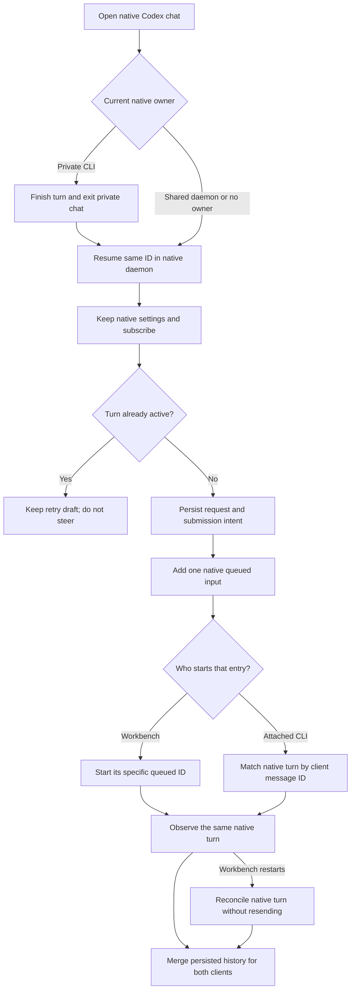

# Codex CLI and Workbench session switching

Workbench web and mobile can continue a native Codex conversation without
copying its transcript into a new thread. Native settings and the native thread
ID remain authoritative. Gateway conversations stay on their isolated runtime.

## Ordinary continuation

1. Finish the current CLI turn and exit that chat if its CLI owns a private runtime.
2. Open the same project and imported Codex conversation in Workbench.
3. Keep **Native CLI** and **Keep native Codex session settings**, then send.
4. To return to the CLI, resume the native session ID, not a Workbench `session_*` ID.

An idle private CLI still owns its thread. Workbench reports that ownership and
restores the rejected draft instead of removing a lock, killing the CLI, or
forking the conversation. Upgrading Workbench does not migrate an already-open
private CLI into the shared daemon.

## Keep the CLI open

Use a Codex version supporting the managed app-server daemon and queue APIs
(tested with `codex-cli 0.158.0`), under the same OS user and `CODEX_HOME` as
Workbench:

```sh
codex app-server daemon start
codex --remote unix:// resume <native-session-id>
```

For a new shared chat, use `codex --remote unix://`. The CLI can stay open while
you send from Workbench, and it displays the same native turns. Wait for a turn
to finish before sending from the other client. Ordinary CLI execution without
`--remote` may still use a private runtime and require the one-time handoff above.

Native Workbench chats automatically connect to the managed daemon. An explicit
private app-server can also be shared: start it with
`codex app-server --listen unix:///absolute/path/codex.sock`, connect the CLI to
that socket with `--remote`, and configure Workbench with
`IO_WORKBENCH_CODEX_APP_SERVER_SOCKET=/absolute/path/codex.sock`. The socket must
belong to the service user and initialize with the same canonical `CODEX_HOME`.

Older CLIs which explicitly reject `app-server daemon` retain private stdio
continuation, but cannot keep that private CLI writer open at the same time.
Connection, home, permission, and writer failures never trigger a new-thread
fallback. Explicit legacy argument/stdin overrides or
`IO_WORKBENCH_CODEX_APP_SERVER_LIVE=false` disable the shared live path.

## Safety and recovery

- Resuming sends only the thread ID and excludes the large history response.
  Workbench does not silently replace the provider, model, cwd, approval policy,
  or sandbox. Explicit chat setting changes are separate native updates.
- The model picker defaults to preserving native settings for imported and
  Workbench-created linked native chats. Installing a CLI or detecting a custom
  provider is not reported as proof of authentication; the runtime verifies it.
  Late mobile catalog replies cannot reset another chat's selected model.
- Shared input uses a stable client message ID and the native queue's specific
  submission ID, never `turn/start` steering. An already-active turn is rejected
  before queueing. If the CLI wins a race after admission, Workbench observes its
  accepted turn; if another turn wins, the one pending entry waits for an idle
  runtime rather than steering or being added again.
- Durable submission intent is committed before sending. Native turn association
  and request IDs prevent a client replay or Workbench restart from generating
  the same accepted prompt again. An ambiguous outcome is reported for inspection,
  not automatically resent.
- Native history is merged with Workbench rows, including later CLI turns,
  while retaining local message IDs, raw slash-command drafts, and errors.
  Workbench does not append synthetic messages to provider-owned rollout files.
- Shared connections close only their own transport, not the daemon or another
  client's CLI. Gateway credentials are never attached to a shared native runtime.
- Native permissions remain in force. Approval and user-input requests currently
  need to be answered in the attached Codex CLI; Workbench warns about this and
  neither auto-declines nor bypasses them. Web/mobile approval controls are not
  part of this switching implementation.



## Verification

```sh
cargo test -p iowb-core -p iowb-storage -p iowb-server --lib
cargo build -p iowb-cli --bin io-workbench
python3 scripts/test-codex-session-switching.py
```

The integration script runs the real Codex TUI, daemon, native protocol and
Workbench HTTP/WebSocket endpoints. A loopback Responses fixture replaces model
calls; credentials, homes, database, sockets and project are disposable. It checks
both history directions, private-writer handoff, active-turn rejection, native
queue atomicity, request deduplication and restart recovery without touching
production conversations or stopping a production daemon. It also verifies that
native approval requests reach a second subscribed client and that a decline
from that client resolves the request without bypassing the native policy.

Protocol reference: <https://learn.chatgpt.com/docs/app-server>.
