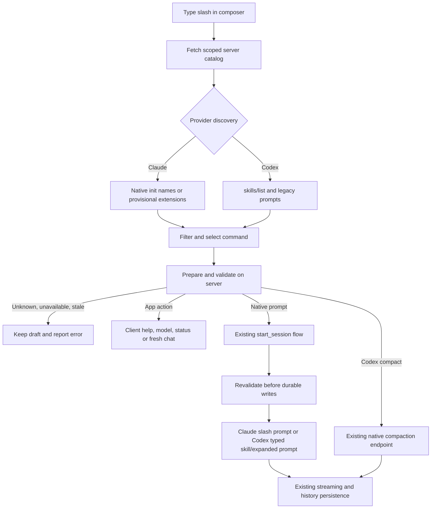

# Chat slash commands

## Usage

In web, native Android, the mobile web harness, or TUI, type `/` at the
beginning of the composer. Commands are available before the first model turn.
Filter by name, select with a click/tap or Up/Down and Tab/Enter, then send.
Escape closes suggestions without clearing the draft.

| Command | Behavior |
| --- | --- |
| `/help` | Show the current command catalog. |
| `/model` | Open model selection for subsequent messages. |
| `/status` | Show provider, selected model, and running/idle state. |
| `/new`, `/clear` | Start an empty chat in the same project; retain the original session and its messages. |
| `/compact` | Request native context compaction in an idle chat with history; retain visible messages. |
| `/mcp` | Show MCP server status: Claude's servers as reported by its last turn, Codex's from the app-server. |
| `/skill-name arguments` | Invoke a discovered provider skill or Claude custom command. |
| `/plugin:command arguments` | Invoke a discovered, enabled Claude plugin command. |
| `/mcp__server__prompt arguments` | Invoke an MCP prompt; always forwarded to the Claude CLI. |
| `/prompts:name arguments` | Expand a legacy Codex prompt on the server before execution. |

An unknown `/name` is rejected only when the provider itself reported its
command list (Claude after a turn has reported `system/init`, Codex after
`skills/list`); the Claude CLI would otherwise send it to the model as a paid
turn. Until then, for Gemini, and after extension files change, the list is
only provisional and an unknown name is forwarded unchanged so CLI built-ins
such as `/init` keep working. Commands the CLI marks terminal-only
(`terminal_slash_commands`) are listed as unavailable. A leading backslash,
for example `\/unknown`, is sent verbatim as plain text and never runs a
command. Paths such as `/tmp/project` and inline mentions such as
`explain /compact` remain ordinary text. A real command cannot be sent with
attachments or an edit-from-here operation; plain text that merely starts with
a slash can.

## Discovery and authority

Discovery runs on the Workbench server, where the provider CLIs and project
files live, not on the browser or phone. It does not create a chat, send a
synthetic first prompt, expand command bodies, or execute shell hooks.

- Claude: scan user/project ancestor `.claude/commands` and `.claude/skills`,
  plus enabled installed plugins. Project definitions override user definitions;
  skills override legacy command definitions in the same scope. Exclude
  `user-invocable: false` definitions. Label filesystem results provisional.
  Once a real Claude turn reports `system/init.slash_commands`, use that native
  list as authority for the matching session, runtime, model and project. The
  same event's `terminal_slash_commands` and `mcp_servers` (name and status)
  are stored with it. Changed extension metadata invalidates the old native
  snapshot; an unchanged `init` neither rewrites it nor invalidates catalogs.
- Codex: use app-server `skills/list` for the project, honor disabled skills,
  and discover legacy `$CODEX_HOME/prompts/*.md`. If native discovery is
  unavailable, show bounded filesystem discovery as provisional. The live
  app-server receives a typed skill input whose path comes from native
  discovery, never from the client. The CLI fallback receives `$skill-name`.
- App actions are reserved and handled by clients. `/compact` is also reserved
  and cannot be shadowed by a same-named extension.

Cache scope includes user, effective provider, runtime, project, session,
model, and CLI configuration environment. Catalogs expire after 15 seconds;
the prepare endpoint refreshes discovery once and the later turn start reuses
that result. Claude init changes and Codex `skills/changed` events invalidate
server catalogs. Clients ignore late catalog/preparation responses after the
selected context or draft changes.

## Backend API

Both endpoints use the existing authentication and workspace boundary checks.
The server resolves runtime from the authenticated user's settings/session;
a client-supplied runtime is not authoritative.

```text
GET /api/chat/commands?provider=claude&projectPath=/workspace/project
    [&sessionId=...][&model=...][&refresh=true]

POST /api/chat/commands/prepare
{"provider":"claude","projectPath":"/workspace/project",
 "sessionId":"...","prompt":"/fixture-check file.txt","commandId":"..."}
```

The catalog contains descriptors, a revision, discovery warnings and
`authoritative`, which is true only when the provider reported the list.
Descriptors include name, description, argument hint, source/kind, action,
availability, unavailability reason and verification status. `commandId` is
optional; when present, preparation verifies it against server discovery.

Preparation returns `{action, prompt, command, message?}` and does not execute
a turn. Supported actions are `prompt`, `help`, `model`, `new`, `status`,
`compact`, and `mcp`; for `mcp` the server fills `message` with the status text.
Clients handle the other app actions locally. Native prompts use the existing
`start_session` WebSocket command; Codex compaction uses the existing
`POST /api/sessions/{sessionId}/compact` endpoint and its request-id/recovery
flow. Normal turn execution revalidates slash input before creating durable
session/run/message side effects, so older or modified clients cannot bypass
the unsupported-command check. Durable user messages retain the original
slash text rather than expanded Codex skill/prompt content.



## Verification

Backend tests cover first-open discovery, unknown/stale/busy inputs, provider
and project boundaries, enabled plugins, hidden extensions, invalidated native
metadata, native Codex discovery and typed skill identity. Client tests cover
parsing, authenticated transport, async scope/draft races, keyboard selection,
fresh-chat behavior and persisted client-generated session IDs. Existing
Claude history, Codex compaction, web viewport and TUI suites remain applicable.

Manual verification uses an isolated server and fake provider executables,
not the active conversation server or paid model requests. It exercises real
web/native Android/TUI clients, native protocol dispatch, and retained history
after command execution and compaction.

### Validation on 2026-11-25

| Suite | Passed |
| --- | ---: |
| Core Rust | 162 |
| Protocol Rust | 15 |
| Server Rust | 719 (1 ignored) |
| TUI Rust | 161 |
| Web slash-command Node/browser | 13 |
| Shared mobile `ChatCommandsTest` (JVM) | 5 |

Only the suites above were re-run for this revision; the wider web, shared
mobile and Android unit suites were not. Backend/TUI builds, the Kotlin/JS web
harness compile and the Android debug assembly also pass. The core suite runs
with the inherited `IO_WORKBENCH_CODEX_APP_SERVER_LIVE` and
`IO_WORKBENCH_CODEX_APP_SERVER_LIVE_IO_GATEWAY` overrides unset: an existing
context-limit test assumes the default CLI branch. The manual-compaction timing
test (`manual_compaction_returns_before_slow_app_server_finishes`) also scans the
real `~/.codex`, so it needs a clean `HOME` on a machine with a large Codex
history. Native
app-server dispatch is verified with fake native protocol responses and, for
`skills/list` and `mcpServerStatus/list`, the installed `codex app-server`.

Manual checks used an isolated server, a fake `claude` executable that emits a
real-shape `system/init`, and no model requests. In headless Chromium they
cover the menu and keyboard, `/help`, `/mcp` before and after the first turn,
unknown-name forwarding then rejection once the CLI reported its list,
terminal-only and MCP-prompt names, and attachment handling. On an Android
emulator (API 35, dark theme) they cover the themed `/help` and `/mcp`
dialogs, Enter with no matching command, and `/new`. Real Claude `/compact`,
native Android UI tests for IME and scroll behavior, and the TUI were not
exercised manually.

The repository-wide line-limit check still reports pre-existing oversized
files outside the new command modules; these are not refactored in this change.
