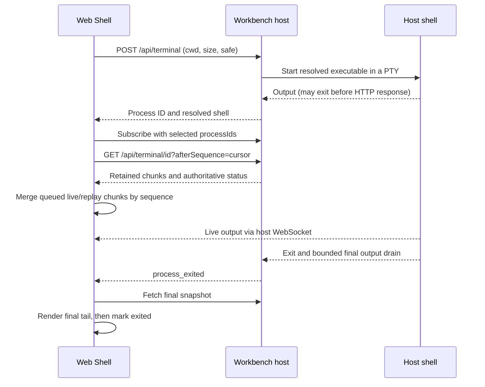

# Host terminals and browser attachment

The browser renders a host PTY; its operating system does not determine which
shell the server can run. Arbitrary command runners continue using
`POST /api/process` unchanged. The Web Shell uses a separate host-shell API.

## Shell selection

Normal terminals resolve an executable in this order:

1. `IO_WORKBENCH_TERMINAL_SHELL`, when explicitly configured.
2. The server's `SHELL` environment variable (`COMSPEC` on Windows).
3. The server user's account shell on Unix.
4. An installed platform fallback: Bash or Sh on Unix; PowerShell or Cmd on Windows.

An unusable implicit candidate is skipped. An unusable explicit profile returns
HTTP 400 instead of silently changing shells. Directories, nonexecutable files,
`false`, and `nologin` are not shell candidates. Bare executable names resolve
against absolute entries in the server's `PATH`. Paths containing spaces remain
literal paths, not shell expressions.

Optional arguments are a JSON string array in
`IO_WORKBENCH_TERMINAL_ARGS`, and require an explicit shell:

```sh
IO_WORKBENCH_TERMINAL_SHELL=/usr/bin/zsh
IO_WORKBENCH_TERMINAL_ARGS='["-l"]'
```

Arguments are passed directly to the executable; neither value is evaluated as
shell code. A default terminal is interactive through its PTY, without adding
login flags. Normal user startup files remain enabled.

**Open safe terminal** is an explicit recovery action, not an automatic fallback
after a startup failure. It ignores the configured shell and arguments. Bash
uses `--noprofile --norc -i`; Sh uses `-i` with `ENV` removed. `BASH_ENV` is also
removed. Windows profile flags disable PowerShell profiles or Cmd AutoRun.
The host-only `IO_WORKBENCH_TOKEN` is removed from every child as before.
Safe mode bypasses user startup configuration; it is not a security sandbox.

## API

Both endpoints use the existing protected API router and authentication policy.

| Endpoint | Request | Response |
|---|---|---|
| `POST /api/terminal` | `{ "cwd": "/host/project", "cols": 100, "rows": 30, "safe": false }` | Process `id`, `started_at`, and `shell: { command, args, source, safe }` |
| `GET /api/terminal/{id}?afterSequence=0` | Optional nonnegative output cursor | `process`, `chunks`, `firstSequence`, `lastSequence`, `running`, `exitCode`, `error` |

Omitted API dimensions default to 80 columns and 24 rows. The browser supplies
its configured dimensions (initially 100 columns and 30 rows). A supplied working
directory must be an allowed host directory. Unknown, expired, or pre-restart
process IDs return HTTP 404. Invalid explicit shell configuration returns HTTP
400 and does not execute a different profile.

Chunks have `{ stream, data, sequence }`; their identities are the same as
WebSocket `process_output` events. `firstSequence` is the oldest retained chunk,
independent of the requested cursor. `lastSequence` is the snapshot watermark.
An empty initial buffer has watermarks 1 and 0. Completion is published after
the bounded output drain; a final snapshot includes the final tail and status.

Active output uses the existing 64 KiB per-process ring. Finished snapshots are
kept in memory for at most five minutes, capped at 64 processes. Retired entries
retain metadata/output, not process controls or PTY writers. This is bounded
recovery history, not durable terminal recording; a host restart discards it.

## Attachment flow



Only events for the selected process reach its screen. Sequenced replay is
deduplicated and ordered, while identical text with different sequence IDs is
preserved. A reconnect refreshes the selected process snapshot and subscription.
While WebSockets are unavailable, the terminal polls snapshots and sends input
through HTTP. The UI reports gaps if output has aged out of the ring.

Switching processes cancels stale attachment requests and resets the emulator,
including parser and alternate-screen state. A stale start response cannot
replace a newer selection, and its newly created process is stopped. Clear
preserves the consumed sequence floor so reconnect replay cannot restore cleared
output. Exit does not trigger an automatic restart loop; Restart or Open safe
terminal explicitly starts a replacement.

## Diagnosing host startup failures

Errors loading `zsh/parameter`, `zsh/zle`, or other native modules are emitted by
the host shell, not xterm or the browser. Verify the executable actually launched,
its version, its compiled module path, and the installed module package together.
Check shell handoffs in startup files as well as the shell selected by the server.

On the affected Linux host, Bash startup executed `~/.local/bin/zsh`, whose
symlink selected a private Zsh 5.9 binary expecting `/usr/lib/zsh/5.9`. The intact
system package instead supplied Zsh 5.9.2 and matching modules. The verified
host-specific repair points that launcher to `/usr/bin/zsh`; shell startup files
and themes are unchanged. Do not copy this repair blindly to other hosts, copy
modules across Zsh versions, or rely on an inherited `MODULE_PATH` override.
Use the explicit safe terminal while repairing a user's normal startup chain.
