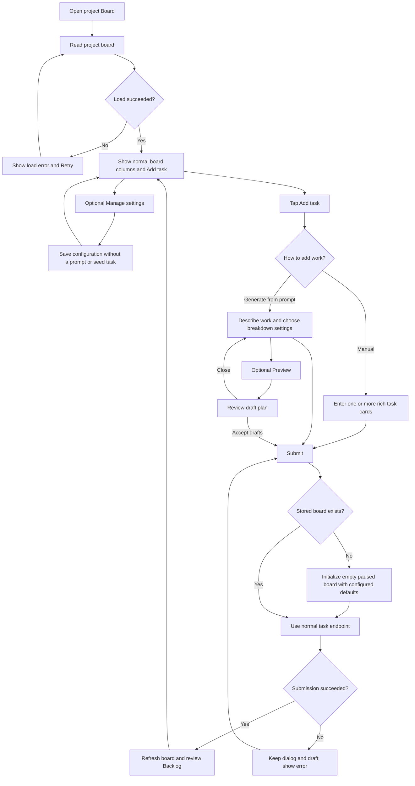
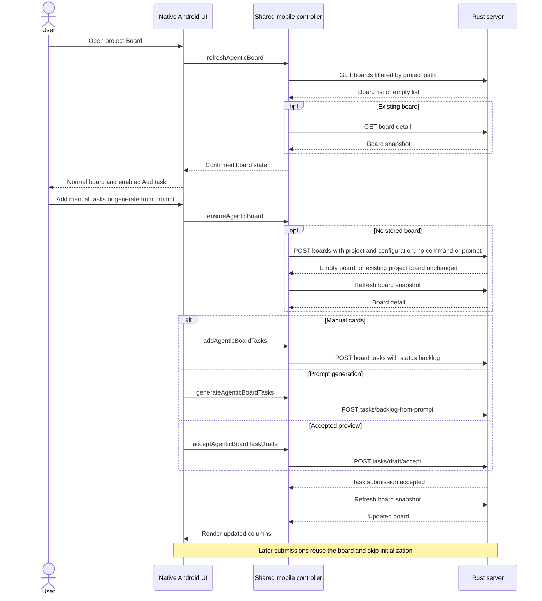
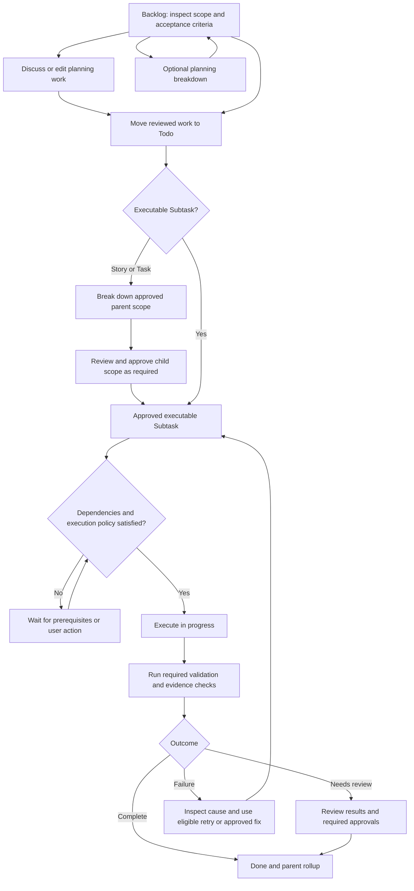

# Mobile Kanban Board Flow

This document describes the native Android app, not the web board.

## Why was an initial prompt required?

Previously, the mobile screen combined board initialization and the first work
item in a **Create board** dialog. The shared controller rejected an empty
prompt, and Add task stayed disabled until a board existed. That was a UI/API
coupling, not a requirement for planning or execution: each task already has its
own prompt, details, and acceptance criteria.

## New first-open behavior

- Opening a project's Board shows its normal columns, counts, and empty states.
- **Add task** works before and after the first task. There is no required
  project-wide prompt and no separate Create board step.
- The first submission initializes an empty paused board transparently, then
  uses the same task endpoint as subsequent submissions. No seed card is added.
- **Manage** is available on the empty board for optional provider, model, and
  board configuration. Saving those settings stores an empty board without
  adding work or starting execution. Otherwise, saved defaults apply on first use.
- Both manual cards and prompt-generated work enter **Backlog** for review.
  Moving reviewed work to **Todo** approves it and starts processing.
- Loading failures are not treated as empty boards: retry loading first.

### Mobile interaction flow

Preview also initializes the empty board when necessary because the draft API
is board-scoped. Previewing alone does not accept the generated cards.

### Initialization and task API flow

## Task usage after addition

Only approved executable Subtasks run. Story and Task cards describe scope and
planning; adding Backlog cards does not grant execution approval. Start resumes
approved work; it is not a substitute for reviewing and approving Backlog.

## Reliability and compatibility

- Initialization is serialized within the mobile controller. Repeated first-use
  actions reuse the initialized board instead of creating extra seed cards.
- The server reuses an existing project board for prompt-free initialization
  without changing its tasks, configuration, or running/paused/scheduled state.
- If initialization succeeds but task submission fails, retry uses the existing
  board. Submission buttons are disabled while a request is in flight, and the
  dialog closes only after success.
- Interrupted initialization is reconciled by reading the board, not blindly
  retrying the create request. Project/connection changes invalidate pending
  initialization, including switching away and back.
- A lost task response can have an uncertain server outcome. Refresh and inspect
  the board before resubmitting; task writes are not guaranteed idempotent.
  Multiple manual cards are submitted individually, so earlier cards may have
  succeeded even if a later card fails.
- The mobile build requires the corresponding server change that permits
  prompt-free initialization. Existing clients may still send a legacy initial
  prompt; those requests continue to create their initial Backlog work item.

## Implementation

- Android board UI: `apps/mobile/androidApp/src/main/kotlin/io/workbench/mobile/ui/board-screen.kt`
- Android navigation: `apps/mobile/androidApp/src/main/kotlin/io/workbench/mobile/ui/lifecycle-and-shell.kt`
- Android dialogs: `apps/mobile/androidApp/src/main/kotlin/io/workbench/mobile/ui/board-dialogs.kt`
- Shared initialization: `apps/mobile/shared/src/commonMain/kotlin/io/workbench/mobile/shared/controller/connection-and-projects.kt`
- Empty-board tests: `apps/mobile/shared/src/commonTest/kotlin/io/workbench/mobile/shared/MobileControllerEmptyBoardTest.kt`
- Server initialization: `crates/iowb-server/src/agentic_board/http/boards.rs` and `crates/iowb-server/src/agentic_board/types.rs`
